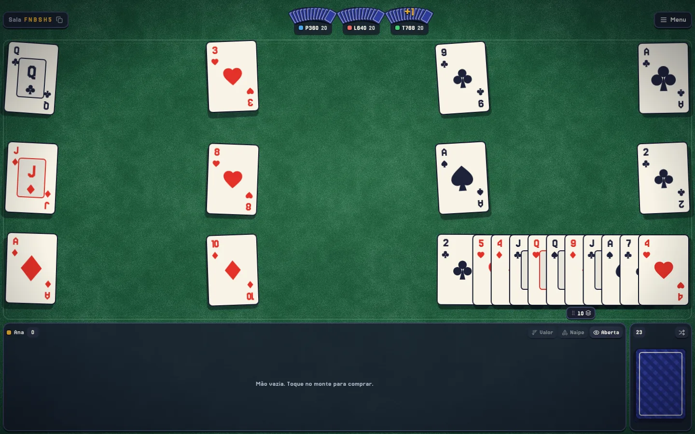

# Virtual Card Playground

Mesa de cartas virtual, livre e em tempo real, para jogar com amigos no
computador ou no celular.

Link: https://ruanps.com.br/virtual-card-playground



## Rodando localmente

```bash
npm install
```

Só o cliente, usando o Firebase:

```bash
npm run dev
```

Com o servidor de tempo real (recomendado), em dois terminais:

```bash
npm run dev:server
```

```bash
VITE_WS_URL=ws://localhost:8787 npm run dev
```

Abra http://localhost:8080/virtual-card-playground/.

## Documentação

Tudo sobre arquitetura, padrões, deploy e fluxos está em [docs/](docs/README.md).
Agentes de IA: leiam [docs/00-regras-para-ia.md](docs/00-regras-para-ia.md)
antes de qualquer alteração.
