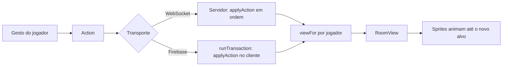

# 1. Arquitetura

## 1.1 Visão geral

O projeto tem três partes, e a do meio é compartilhada pelas outras duas:

```
virtual-card-playground/
├── shared/      Motor do jogo, tipos e protocolo. TypeScript puro, sem React nem Node.
├── server/      Servidor de tempo real (Node + ws). Opcional.
└── src/         Cliente React (Vite), publicado como site estático.
```

A decisão central: **existe um único lugar que sabe o que uma ação faz ao
estado**, a função pura `applyAction` de [`shared/engine.ts`](../shared/engine.ts).
O servidor a usa para arbitrar a sala; o cliente a usa dentro de uma transação
do Firebase quando não há servidor. Nenhum componente altera o estado do jogo
por conta própria.



## 1.2 Por que esta arquitetura (o que ela corrigiu)

A versão anterior sincronizava assim: cada cliente lia a sala inteira do
Firebase com `get`, alterava a cópia e gravava a sala inteira de volta com
`set`. Os defeitos relatados vinham diretamente disso:

| Sintoma relatado | Causa na versão anterior | Como a arquitetura atual resolve |
|---|---|---|
| Cartas trocando de lugar ou sumindo quando duas pessoas agiam juntas | `get` seguido de `set` da sala inteira: a escrita mais lenta apagava a do outro | Servidor aplica as ações em fila; no Firebase, `runTransaction` repete a ação se alguém gravou no meio |
| Ordem errada ao tirar carta de grupo ou reordenar a mão | Ações apontavam para a carta pelo **índice**, que muda quando outro jogador mexe | Toda ação aponta pelo **id** da carta; a mão usa "antes da carta X" |
| Carta movida no desktop some no celular | Posição salva em **pixels** da tela de quem moveu | Posição normalizada de 0 a 1, projetada na área útil de cada tela |
| Arrastar não funcionava no celular | Drag and drop nativo do HTML5, que não dispara em toque | Pointer Events, iguais para mouse, dedo e caneta |
| Cartas "teleportando" | Sem estado intermediário durante o arrasto | Arrasto ao vivo transmitido como mensagem efêmera |
| Baralho encolhendo quando alguém saía | O jogador era apagado junto com as cartas da mão | A mão volta para o fundo do monte |

## 1.3 Camadas

### shared/ (motor, contrato)

| Arquivo | Responsabilidade |
|---|---|
| [`cards.ts`](../shared/cards.ts) | Naipes, valores, ordenação |
| [`ids.ts`](../shared/ids.ts) | Ids de carta e código da sala (sem caracteres ambíguos) |
| [`types.ts`](../shared/types.ts) | `RoomState`, `Action`, `RoomView`, `LiveMessage`, códigos de erro |
| [`engine.ts`](../shared/engine.ts) | `applyAction`, `createRoomState`, `addPlayer`, `removePlayer`, `setConnected`, `normalizeState` |
| [`view.ts`](../shared/view.ts) | `viewFor`: recorta o estado para o que um jogador pode saber |
| [`pileOrder.ts`](../shared/pileOrder.ts) | Ordem de exibição do leque (livre, valor, manilha) |
| [`manilha.ts`](../shared/manilha.ts) | Ordem de manilha da sala: predefinições, validação e força de cada carta |
| [`protocol.ts`](../shared/protocol.ts) | Mensagens do WebSocket |

### server/ (tempo real autoritativo)

| Arquivo | Responsabilidade |
|---|---|
| [`index.ts`](../server/index.ts) | HTTP (`/healthz`), WebSocket em `/ws`, limite de taxa, heartbeat, snapshot em disco |
| [`rooms.ts`](../server/rooms.ts) | `RoomManager`: salas em memória, tokens de assento, broadcast da visão de cada jogador |

O servidor manda para cada jogador **só a visão dele** (`viewFor`): o monte
chega como contagem, a mão dos outros também, e carta virada para baixo chega
sem naipe e valor. Quem abrir as ferramentas do navegador não descobre cartas
escondidas.

### src/ (cliente)

```
src/
├── pages/            Index (entrada ou mesa) e NotFound
├── components/
│   ├── game/         Tudo da mesa: palco, camada de cartas, barra, mão, efeitos
│   ├── ui/           Primitivos shadcn/ui (botão, diálogo, menu...)
│   ├── RoomSetup.tsx Tela de entrada
│   └── ...Dialog.tsx Diálogos reaproveitados
├── game/             Geometria pura da mesa e cálculo de alvos dos sprites
├── hooks/            Sala, arrasto, medidas do palco, efeitos, transições
└── lib/
    ├── realtime/     Transportes (WebSocket e Firebase) e sessão
    ├── i18n.ts       Textos pt-BR e en
    ├── sfx.ts        Sons sintetizados
    ├── preference.ts Preferências do jogador no navegador
    ├── felt.ts       Cor da mesa (verde ou vinho)
    ├── opponentsView.ts Adversários como etiquetas ou leques
    ├── feltTexture.ts Textura de tecido do feltro
    ├── pwa.ts        Service worker e instalação do app
    └── tokens.ts     Leitura dos tokens de cor em JS
```

## 1.4 Transportes de tempo real

O cliente fala com uma interface única, `RoomConnection`
([`src/lib/realtime/types.ts`](../src/lib/realtime/types.ts)). Qual
implementação é usada depende de uma variável de build:

| `VITE_WS_URL` | Transporte | Quando usar |
|---|---|---|
| definida (`wss://...`) | WebSocket ([`wsTransport.ts`](../src/lib/realtime/wsTransport.ts)) | **Recomendado.** Ordem garantida pelo servidor, cartas escondidas de verdade, menor latência |
| vazia | Firebase ([`firebaseTransport.ts`](../src/lib/realtime/firebaseTransport.ts)) | Hospedagem só estática, sem servidor próprio |

Por que WebSocket com servidor autoritativo é a recomendação: o servidor é o
único que aplica ações, então não existe conflito para resolver; cada
confirmação (`ack`) chega depois do estado novo, então o cliente nunca vê a
carta "voltar"; e o servidor filtra o que cada um vê. O Firebase continua
suportado porque o projeto é publicado no GitHub Pages e precisa funcionar sem
servidor.

### Protocolo WebSocket

Cliente para servidor (`ClientMessage`):

| `t` | Campos | Efeito |
|---|---|---|
| `create` | `name` | Cria sala e assento |
| `join` | `roomId`, `name` | Entra em sala existente |
| `resume` | `roomId`, `playerId`, `token` | Volta ao mesmo assento (recarregar, queda) |
| `action` | `id`, `action` | Pede uma ação; resposta em `ack` com o mesmo `id` |
| `live` | `msg` | Posição de arrasto ao vivo (não persiste) |
| `leave` | | Sai da sala; a mão volta ao monte |
| `ping` | | Mantém a conexão |

Servidor para cliente (`ServerMessage`): `joined`, `state` (a `RoomView`),
`ack`, `live`, `error`, `closed` (`left`, `removed`, `replaced`, `room_gone`) e `pong`.

### Garantias

- **Ordem:** o servidor processa mensagens de um socket em sequência e aplica
  ações de todos em uma fila única (o laço de eventos do Node).
- **Confirmação:** `ack` sai depois do `state`. Enquanto não chega, a carta
  solta fica parada onde o jogador a deixou.
- **Reconexão:** backoff exponencial até 8 s, tentativa imediata ao voltar para
  a aba ou recuperar a rede, ping a cada 20 s e conexão dada como morta após
  45 s de silêncio.
- **Sobrevivência a reinício:** com `ROOMS_FILE`, o servidor salva as salas a
  cada 10 s e ao receber SIGTERM, e as recarrega no boot. Os clientes voltam
  sozinhos ao mesmo assento.
- **Limites:** 80 mensagens por segundo por conexão, 8 KB por mensagem, 8
  jogadores por sala, 416 cartas por sala, `MAX_ROOMS` salas.

## 1.5 Renderização da mesa

Todas as cartas visíveis vivem em **uma camada só**
([`CardLayer`](../src/components/game/CardLayer.tsx)). Mesa, grupo e mão não
são contêineres: são **alvos**. A cada `RoomView` nova,
[`computeTargets`](../src/game/targets.ts) calcula onde cada carta deve estar e
cada sprite persegue o próprio alvo com uma mola. Por isso uma carta voa da mão
para a mesa (ou do monte para a mão de outro jogador) sem ser desmontada.

Durante o arrasto, o controlador escreve direto nos valores de movimento do
sprite (sem render do React por quadro). Ao soltar, resolve o alvo sob o
ponteiro pelo DOM (`document.elementsFromPoint` e o atributo `data-drop`) e
envia **uma** ação.

## 1.6 Rotas

| Rota | Página |
|---|---|
| `/virtual-card-playground/` | [`Index`](../src/pages/Index.tsx): entrada ou mesa |
| `/virtual-card-playground/?sala=CODIGO` | Entrada já no modo "entrar", com o código preenchido (link de convite) |
| qualquer outra | [`NotFound`](../src/pages/NotFound.tsx) |

O prefixo `/virtual-card-playground` vem de `base` no
[`vite.config.ts`](../vite.config.ts) e de `basename` no
[`App.tsx`](../src/App.tsx), por causa do GitHub Pages.

Servidor: `GET /healthz` (saúde e número de salas) e WebSocket em `/ws`.

## 1.7 App instalável (PWA)

O [`vite-plugin-pwa`](https://vite-pwa-org.netlify.app/) gera no build o
manifesto (`manifest.webmanifest`) e um service worker do Workbox (`sw.js`),
ambos sob `/virtual-card-playground/`. A configuração fica no
[`vite.config.ts`](../vite.config.ts).

- O service worker guarda os arquivos do app (HTML, JS, CSS, fonte, ícones),
  com versão, para abrir rápido e funcionar sem rede até a tela de entrada.
- Ele **não** intercepta o tempo real: o WebSocket e o Firebase são de outra
  origem, e o estado da sala nunca vai para o cache.
- O registro fica em [`src/lib/pwa.ts`](../src/lib/pwa.ts) e só acontece no
  build de produção. No `npm run dev` não há service worker, para ele não
  guardar arquivos velhos e atrapalhar a recarga do Vite. Para testar o PWA:
  `npm run build` e `npx vite preview`.
- Versão nova: o service worker novo espera, e o jogador vê o aviso com o
  botão Atualizar. Nada recarrega sozinho no meio de uma partida.
