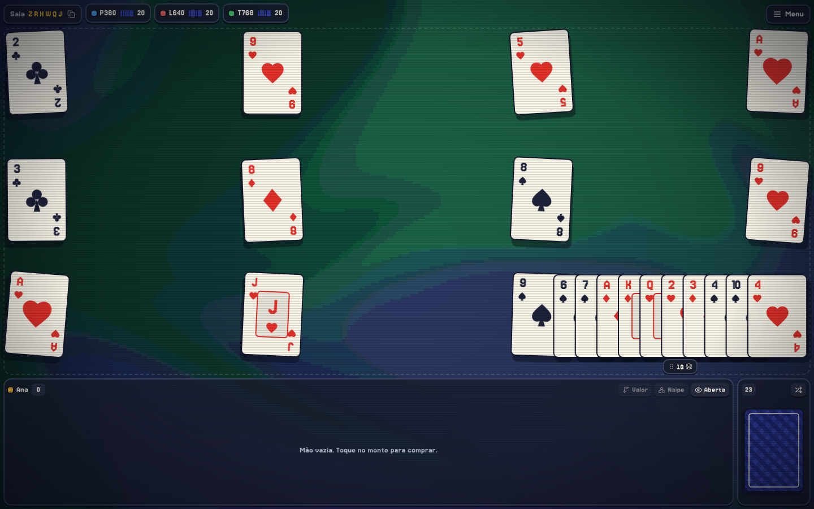

# 3.1 Identidade visual

## 3.1.1 Direção

A mesa tem estética de jogo de cartas em pixel art, com bastante "suco":
fundo de tinta em redemoinho, cartas que flutuam e balançam, inclinação 3D ao
passar o mouse, viradas com estalo, partículas e números que saltam. A
referência é o tipo de sensação de jogos de cartas como Balatro (impacto,
movimento contínuo, feedback em cada ação), mas o visual é próprio: cartas,
cores, fundo e sons foram desenhados para este projeto, sem copiar arte,
nome ou elementos de nenhum jogo.

Princípios:

1. **Toda ação responde.** Comprar, soltar, virar, agrupar, embaralhar: cada
   uma tem som, movimento e, quando faz sentido, partícula ou texto.
2. **Os efeitos valem para todos.** Eles nascem do último evento do estado
   (`view.last`), e não do gesto local, então quem está do outro lado vê e
   ouve a mesma coisa.
3. **Sombra dura, sem desfoque.** Painéis, botões e cartas usam sombra deslocada
   de cor sólida, como em pixel art. Nada de `blur` em sombra.
4. **Movimento com peso.** Molas levemente subamortecidas (passam um pouco do
   alvo e assentam), nunca deslizes lineares.

## 3.1.2 Tema

**Tema único, escuro.** Não há modo claro. A mesa é um ambiente de jogo, e um
modo claro exigiria redesenhar fundo, cartas e efeitos. `color-scheme: dark`
está definido em `:root`.

## 3.1.3 Tokens de cor

Todos em [`src/index.css`](../src/index.css), no formato `H S% L%` (sem
`hsl()`), para o Tailwind poder aplicar opacidade (`bg-card/80`).

### Interface

| Token | Valor | Uso |
|---|---|---|
| `--background` | `224 36% 9%` | Fundo da página |
| `--foreground` | `44 45% 93%` | Texto principal (creme) |
| `--card` | `226 30% 14%` | Painéis, barra, bandeja da mão |
| `--popover` | `226 32% 12%` | Menus |
| `--primary` | `41 96% 58%` | Dourado: destaque, título, botão principal, alvo de soltura |
| `--secondary` | `206 86% 58%` | Azul: botão secundário, seletor ativo |
| `--muted` | `226 24% 21%` | Fundo de contadores e botões pequenos |
| `--muted-foreground` | `224 18% 72%` | Texto secundário |
| `--accent` | `226 26% 24%` | Hover |
| `--destructive` | `3 80% 60%` | Sair, remover, reiniciar |
| `--border`, `--input` | `226 24% 32%` | Bordas |
| `--ring` | igual a `--primary` | Foco |
| `--shadow` | `228 55% 4%` | Cor das sombras duras |

### Mesa e cartas

| Token | Uso |
|---|---|
| `--felt-1`, `--felt-2`, `--felt-3` | As três tintas do fundo em redemoinho (shader) |
| `--pc-paper` | Frente da carta |
| `--pc-ink` | Naipes pretos e texto da carta |
| `--pc-red` | Naipes vermelhos |
| `--pc-edge` | Contorno da carta |
| `--pc-back`, `--pc-back-deep` | Verso (padrão xadrez diagonal) |
| `--pc-shine` | Brilho que segue o mouse |

### Assentos

`--seat-0` até `--seat-7`: uma cor por assento, usada no ponto da etiqueta do
jogador e no contorno da carta que ele está arrastando. Acesse com
`seatColor(seat)` de [`src/game/stage.ts`](../src/game/stage.ts).

### Cor fora do CSS

Canvas e WebGL não enxergam classes. Use
[`tokenColor('--primary', 0.5)`](../src/lib/tokens.ts) para uma string CSS e
`tokenRgb('--felt-1')` para o vetor que o shader espera. Nunca escreva um
`#hex` ou `rgb()` no código.

## 3.1.4 Tipografia

| Item | Valor |
|---|---|
| Fonte | **Jersey 15** (pixel), via `@fontsource/jersey-15`, empacotada |
| Família no Tailwind | `font-sans` aponta para ela, com fallback monoespaçado |
| Corpo | 16px |
| Peso | só 400; `font-synthesis: none` impede o navegador de "engrossar" e borrar |
| Título da entrada | `text-3xl` em `text-primary` |

Ela foi escolhida entre outras fontes pixel por ser a mais legível em tamanho
pequeno com acentos do português (testado em 14 a 16px). Pixel fonts precisam
de tamanhos maiores que fontes comuns: o menor texto da interface é 14px.

Dentro da carta, o tamanho vem do sprite: `font-size` é 20% da largura da
carta e todas as medidas internas são em `em`. A carta escala inteira, do
celular ao desktop, sem regras próprias.

## 3.1.5 Cartas

- Proporção 5:7, cantos de `0.42em`.
- Índice (valor e naipe) nos dois cantos, o de baixo girado 180 graus.
- Centro: naipe grande; o Ás tem naipe maior; J, Q e K têm um quadro com a letra.
- Naipes em SVG ([`SuitIcon`](../src/components/game/CardFace.tsx)), nunca
  caracteres Unicode, que viram emoji em vários celulares.
- Verso com padrão xadrez diagonal e moldura creme.
- Sombra: elemento próprio (`.pc-shadow`), deslocado para longe do centro da
  tela, como se a luz viesse do centro. Cresce quando a carta é levantada.

## 3.1.6 Animações e efeitos

| Efeito | Onde | Como |
|---|---|---|
| Fundo em redemoinho | Toda a tela | Shader WebGL em 1/5 da resolução, ampliado com `image-rendering: pixelated`, 30 quadros por segundo, pausa com a aba oculta |
| Linhas de varredura e vinheta | Por cima de tudo | `.stage-crt`, gradientes CSS |
| Flutuação | Cartas da mesa e da mão | `@keyframes pc-bob`, cada carta com atraso próprio |
| Inclinação 3D | Hover do mouse | Variáveis `--rx`, `--ry` escritas direto no elemento |
| Brilho | Hover do mouse | Gradiente radial em `--sx`, `--sy` |
| Inclinação no arrasto | Carta segurada | Gira na direção do movimento e volta ao eixo |
| Voo | Toda mudança de lugar | Mola (`stiffness 360`, `damping 30`) |
| Virada | Tocar na carta | `rotateY` com curva que passa do ponto |
| Pulo | Carta que pousou, foi virada ou chegou à mão | Escala 1.2, 0.93, 1 |
| Poeira | Carta pousada na mesa | Partículas creme para os lados |
| Faíscas | Grupo criado | Partículas dourado e creme em círculo |
| Confete | Baralho adicionado, jogo reiniciado | 40 partículas de quatro cores |
| Texto flutuante | `+1` ao entregar, `+52` ao adicionar, `-N` ao remover | Sobe, cresce e some |
| Tremor de tela | Embaralhar, reiniciar | Web Animations API no palco |
| Embaralhada | Monte | Camadas do monte se abrem e fecham |

Sons ([`sfx.ts`](../src/lib/sfx.ts)): todos sintetizados (ruído filtrado e tons
curtos), com pequena variação de tom a cada toque. Botão de som no menu; a
escolha fica no navegador.

### Movimento reduzido

Com `prefers-reduced-motion: reduce`: sem fundo animado (fica um quadro
parado), sem flutuação, sem embaralhada animada, sem partículas e sem tremor.
O voo das cartas continua, porque ele informa o que aconteceu.

### Custo

Os efeitos foram pensados para celular: o fundo roda em resolução baixa, o
laço de partículas só existe enquanto há partícula viva, a sombra é um
elemento e não `filter`, e o arrasto não renderiza o React por quadro.
