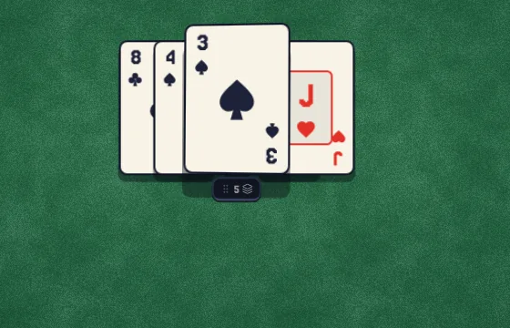
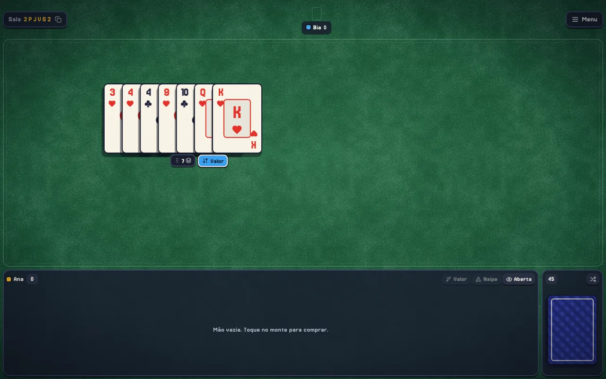
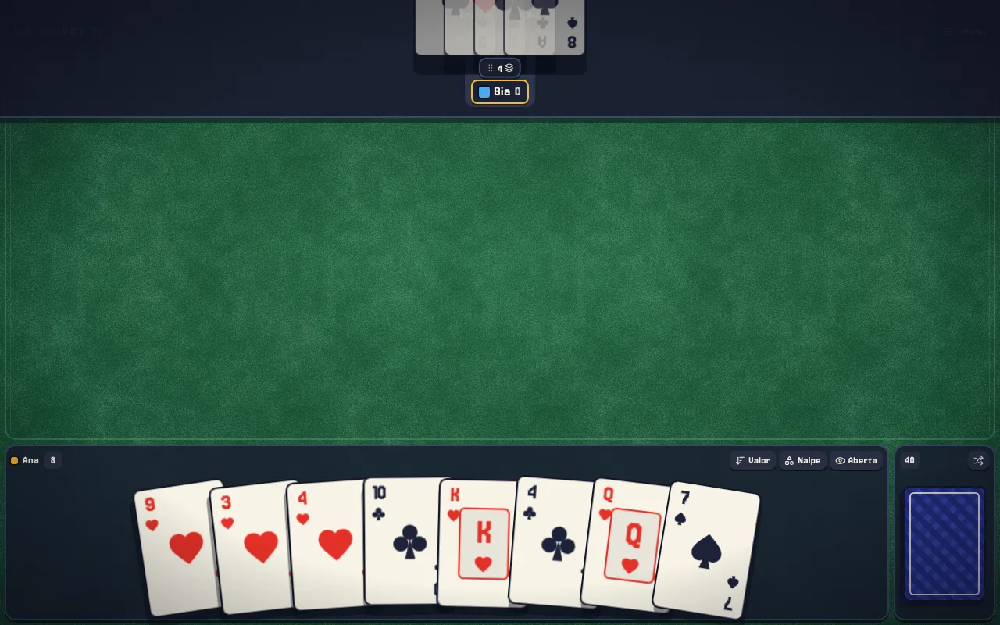
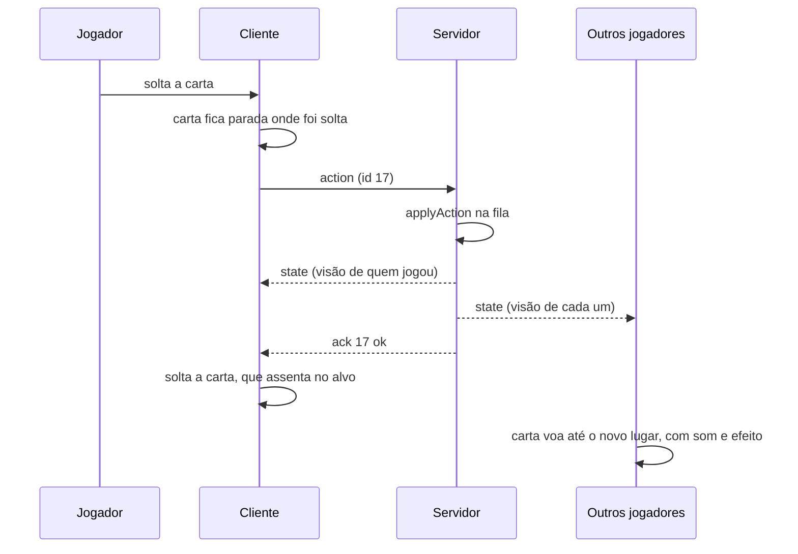
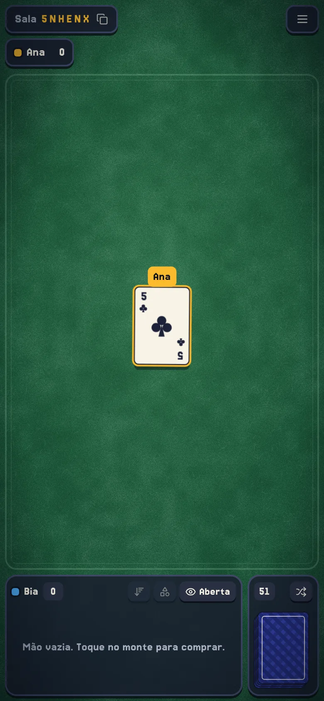

# 7. Fluxos da aplicação

## 7.1 Entrar

1. **Criar sala:** nome e "Criar sala". A sala nasce com um baralho de 52
   cartas embaralhado. O código vai para a URL (`?sala=K7M2QX`), então o
   endereço da aba já serve de convite.
2. **Entrar em sala:** nome e código. Quem abre um link de convite já cai neste
   modo com o código preenchido.
3. O nome fica salvo no navegador para a próxima vez.

Erros possíveis: sala não encontrada, sala cheia (8 jogadores), sem conexão.

## 7.2 Retomar depois de recarregar

O assento fica no `sessionStorage` da aba. Ao recarregar, `useRoom` tenta
`resume` até três vezes; o jogador volta ao mesmo lugar, com a mesma mão. Se a
sala acabou ou o assento não existe mais, volta para a entrada com aviso.
Cada aba tem a sua sessão: duas abas no mesmo navegador são dois jogadores.

## 7.3 Jogar

| Gesto | Resultado |
|---|---|
| Tocar no monte | Compra uma carta para a sua mão |
| Arrastar do monte para a mesa | Carta pousa ali (aberta ou fechada, conforme o seletor) |
| Arrastar da mão para a mesa | Idem, saindo da mão |
| Arrastar dentro da mão | Reordena; uma vaga se abre onde a carta vai entrar |
| Tocar em carta da mesa | Vira |
| Soltar carta sobre outra (centros próximos) | Cria um grupo em pilha |
| Soltar carta sobre um grupo em pilha | Entra no topo do grupo |
| Soltar carta sobre um grupo em leque | Entra na posição onde for solta; uma vaga se abre no leque para mostrar onde |
| Arrastar uma carta dentro do leque | Reordena o grupo, como na mão (qualquer jogador pode, o grupo está na mesa) |
| Arrastar a etiqueta do grupo pela mesa | Move o grupo inteiro |
| Soltar a etiqueta do grupo sobre o monte | O grupo inteiro volta para o topo do monte |
| Soltar a etiqueta do grupo na sua mão | Todas as cartas do grupo vão para o fim da sua mão |
| Soltar a etiqueta do grupo sobre um jogador | Todas as cartas vão para a mão dele (a barra ampliada também aparece) |
| Soltar a etiqueta do grupo sobre outro grupo | Os dois grupos se unem |
| Soltar a etiqueta do grupo sobre uma carta solta | A carta vira a base do grupo, e o grupo vai para onde ela está |
| Botão ao lado da etiqueta (só no leque) | Escolhe a ordem do leque: livre, valor ou manilha |
| Tocar na etiqueta do grupo | Alterna pilha e leque |
| Arrastar carta de um grupo para fora dele | Tira a carta do grupo; as outras se juntam |
| Levar a carta até o topo da tela | A barra de jogadores aparece ampliada, com alvos grandes |
| Soltar sobre um jogador | A carta vai para a mão dele |
| Soltar sobre o monte | A carta volta para o topo do monte |
| Botões Valor e Naipe | Ordenam a sua mão |
| Seletor Aberta/Fechada | Define como as cartas da mão e do monte chegam à mesa |

Menu: adicionar baralho, remover um baralho, remover cartas do monte,
reiniciar (tudo volta ao monte), reiniciar com um baralho original, cor da mesa
(feltro verde ou vinho), adversários (leques de cartas, o padrão, ou
etiquetas), som, idioma, ajuda, instalar app e sair. A cor da mesa também pode ser escolhida
na tela de entrada. As duas escolhas de visual valem só para quem escolheu.

### Baralhos no monte

- **Adicionar baralho:** 52 cartas novas entram no monte, que é embaralhado.
- **Remover um baralho:** sai do monte uma cópia de cada carta. Uma carta com
  uma cópia só nunca sai, então a mesa mantém pelo menos um baralho (com um
  baralho só, a opção fica desabilitada). Se as cópias extras de alguma carta
  estiverem na mesa ou nas mãos, ela fica, e o aviso diz quantas ficaram.
- **Remover cartas do monte:** por valor ou naipe (por exemplo, para truco).
- **Reiniciar jogo:** tudo volta ao monte, com a composição atual.
- **Reiniciar com um baralho original:** tudo sai da mesa e das mãos, e o
  monte volta a ser um único baralho de 52 cartas, embaralhado. Desfaz baralhos
  adicionados e cartas removidas.

Todas pedem confirmação e valem para a sala inteira.

### Instalar o app

A mesa é um PWA: pode ser instalada como app no celular e no computador, e
abre pelo ícone, em tela cheia e sem a barra do navegador. A opção "Instalar
app" fica no menu da mesa e na tela de entrada, e some quando o app já está
aberto como app instalado.

- Chrome, Edge e Android: a opção abre o pedido de instalação do navegador.
  A faixa automática que o Chrome mostra no celular é suprimida, para não
  aparecer por cima da mesa no meio do jogo.
- iPhone e iPad (Safari): abre o passo a passo (Compartilhar, Adicionar à Tela
  de Início), porque o Safari não oferece instalação direta pela página.
- Outros navegadores: abre o caminho pelo menu do navegador.

Quando sai uma versão nova, aparece o aviso "Há uma versão nova da mesa" com o
botão Atualizar. A página não recarrega sozinha, para não interromper uma
jogada; ao atualizar, o jogador volta ao mesmo assento.

### Entregar carta pela barra ampliada

Quando uma carta arrastada chega perto do topo da tela, a barra de jogadores
aparece por cima, bem maior (o título diz "Entregar para"). Ao passar sobre um
jogador, o alvo se destaca, o título passa a dizer "Entregar para Fulano" e a
carta encolhe e fica translúcida para não esconder o nome. Ao afastar a carta
do topo, a barra some e a carta pode ser solta na mesa normalmente. A barra
não empurra o layout: as cartas da mesa não se mexem enquanto ela aparece.

### Reordenar um grupo em leque

Com o grupo aberto em leque, arrastar uma carta dele faz as outras se
juntarem, e uma vaga se abre na posição mais próxima do centro da carta. Ao
soltar, a carta entra ali. Soltar de volta na mesma vaga não envia nada. O
leque reconhece a carta pela posição do centro dela, com folga, e não só pelo
dedo: quem segura a carta pela borda no celular continua acertando o leque.
Em pilha não há posição visível, então a carta sempre entra no topo.

### Ordem do leque

Com o grupo aberto em leque aparece, ao lado da etiqueta, o botão de ordem:

| Opção | Ordem |
|---|---|
| Livre (padrão) | A ordem manual: você arrasta as cartas para onde quiser |
| Valor | Do 2 ao Ás (Ás alto); naipe como desempate |
| Manilha (truco) | Força do truco, do 4 ao 3 (4, 5, 6, 7, Q, J, K, A, 2, 3); empate pelo naipe das manilhas: ouros, espadas, copas, paus. Se houver 8, 9 ou 10, ficam depois do 7 |

Valor e manilha se atualizam sozinhos quando cartas entram ou saem. Enquanto o
leque está ordenado, não há vaga para escolher: uma carta nova entra na
posição da ordenação. Voltar para "Livre" recupera a ordem manual, com as
cartas que entraram nesse meio tempo no fim, e o arrasto livre volta a valer.
Cartas viradas para baixo ficam no fim, fora da ordenação. A ordem vale para
a sala inteira, e a pilha (modo empilhado) sempre usa a ordem manual.

### Levar o grupo inteiro

A etiqueta do grupo funciona como uma carta grande: o destino é o que estiver
embaixo dela ao soltar. As cartas vão juntas, numa ação só. Ao passar sobre um
jogador, o grupo fica translúcido para o nome aparecer.

## 7.4 Ciclo de uma ação

Se a ação for recusada (por exemplo, a carta já não estava lá porque outro
jogador a pegou antes), o `ack` vem com o código de erro, a carta volta ao
lugar e aparece um aviso.

## 7.5 Arrasto ao vivo

Enquanto alguém arrasta uma carta que já está na mesa (ou um grupo), a posição
é transmitida cerca de 18 vezes por segundo como mensagem efêmera
(`LiveMessage`). Os outros veem a carta acompanhando o dedo de quem arrasta,
com o nome dele em cima e o contorno na cor do assento. Nesse intervalo
ninguém mais pode pegar aquela carta.

Carta saindo da **mão** não é transmitida: mostrar o movimento entregaria de
onde ela veio antes de ser jogada.

## 7.6 Queda de conexão

1. A barra mostra "Reconectando...".
2. O cliente tenta de novo com espera crescente (até 8 s), e na hora ao voltar
   para a aba ou recuperar a rede.
3. Ao reconectar, recebe o estado atual e o aviso "Conexão restabelecida".
4. Para os outros, o jogador aparece como desconectado (ícone e borda
   tracejada). Um jogador desconectado pode ser removido por qualquer outro;
   a mão dele volta ao monte.

Se o servidor reiniciar com `ROOMS_FILE`, todos voltam sozinhos para a mesma
sala.

## 7.7 Sair

"Sair da sala" pede confirmação, devolve a mão ao fundo do monte e libera o
assento. Quando o último jogador sai, a sala é apagada. Fechar a aba sem sair
mantém o assento reservado até a sala expirar.
