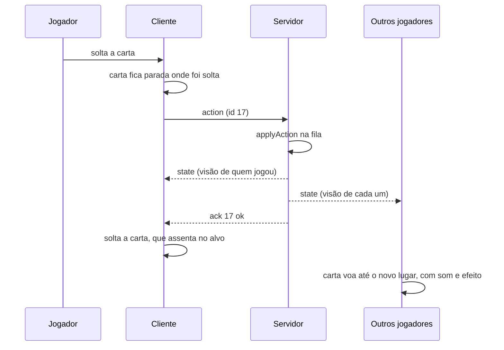
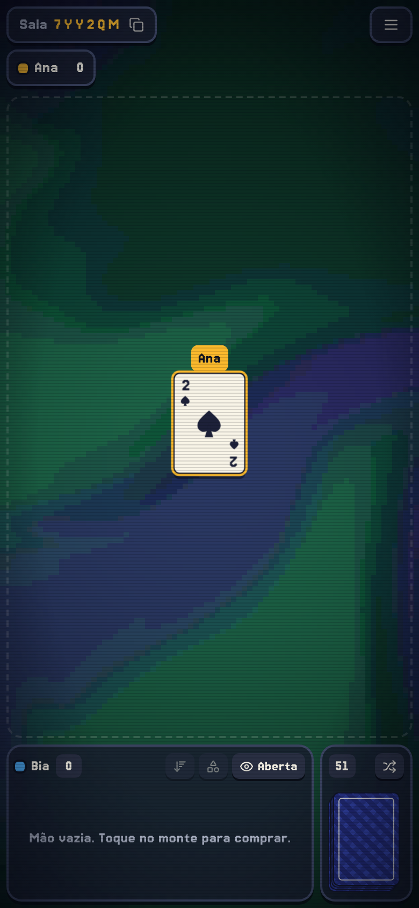

# 7. Fluxos da aplicação

## 7.1 Entrar

1. **Criar sala:** nome e "Criar sala". A sala nasce com um baralho de 52
   cartas embaralhado. O código vai para a URL (`?sala=K7M2QX`), então o
   endereço da aba já serve de convite.
2. **Entrar em sala:** nome e código. Quem abre um link de convite já cai neste
   modo com o código preenchido.
3. O nome fica salvo no navegador para a próxima vez.

Erros possíveis: sala não encontrada, sala cheia (8 jogadores), sem conexão.

## 7.2 Retomar depois de recarregar

O assento fica no `sessionStorage` da aba. Ao recarregar, `useRoom` tenta
`resume` até três vezes; o jogador volta ao mesmo lugar, com a mesma mão. Se a
sala acabou ou o assento não existe mais, volta para a entrada com aviso.
Cada aba tem a sua sessão: duas abas no mesmo navegador são dois jogadores.

## 7.3 Jogar

| Gesto | Resultado |
|---|---|
| Tocar no monte | Compra uma carta para a sua mão |
| Arrastar do monte para a mesa | Carta pousa ali (aberta ou fechada, conforme o seletor) |
| Arrastar da mão para a mesa | Idem, saindo da mão |
| Arrastar dentro da mão | Reordena; uma vaga se abre onde a carta vai entrar |
| Tocar em carta da mesa | Vira |
| Soltar carta sobre outra (centros próximos) | Cria um grupo em pilha |
| Soltar carta sobre um grupo | Entra no grupo |
| Arrastar a etiqueta do grupo | Move o grupo inteiro |
| Tocar na etiqueta do grupo | Alterna pilha e leque |
| Arrastar carta de um grupo | Tira a carta do grupo |
| Soltar sobre o nome de um jogador | A carta vai para a mão dele |
| Soltar sobre o monte | A carta volta para o topo do monte |
| Botões Valor e Naipe | Ordenam a sua mão |
| Seletor Aberta/Fechada | Define como as cartas da mão e do monte chegam à mesa |

Menu: adicionar baralho, remover cartas do monte, reiniciar (tudo volta ao
monte), som, idioma, ajuda e sair.

## 7.4 Ciclo de uma ação

Se a ação for recusada (por exemplo, a carta já não estava lá porque outro
jogador a pegou antes), o `ack` vem com o código de erro, a carta volta ao
lugar e aparece um aviso.

## 7.5 Arrasto ao vivo

Enquanto alguém arrasta uma carta que já está na mesa (ou um grupo), a posição
é transmitida cerca de 18 vezes por segundo como mensagem efêmera
(`LiveMessage`). Os outros veem a carta acompanhando o dedo de quem arrasta,
com o nome dele em cima e o contorno na cor do assento. Nesse intervalo
ninguém mais pode pegar aquela carta.

Carta saindo da **mão** não é transmitida: mostrar o movimento entregaria de
onde ela veio antes de ser jogada.

## 7.6 Queda de conexão

1. A barra mostra "Reconectando...".
2. O cliente tenta de novo com espera crescente (até 8 s), e na hora ao voltar
   para a aba ou recuperar a rede.
3. Ao reconectar, recebe o estado atual e o aviso "Conexão restabelecida".
4. Para os outros, o jogador aparece como desconectado (ícone e borda
   tracejada). Um jogador desconectado pode ser removido por qualquer outro;
   a mão dele volta ao monte.

Se o servidor reiniciar com `ROOMS_FILE`, todos voltam sozinhos para a mesma
sala.

## 7.7 Sair

"Sair da sala" pede confirmação, devolve a mão ao fundo do monte e libera o
assento. Quando o último jogador sai, a sala é apagada. Fechar a aba sem sair
mantém o assento reservado até a sala expirar.
