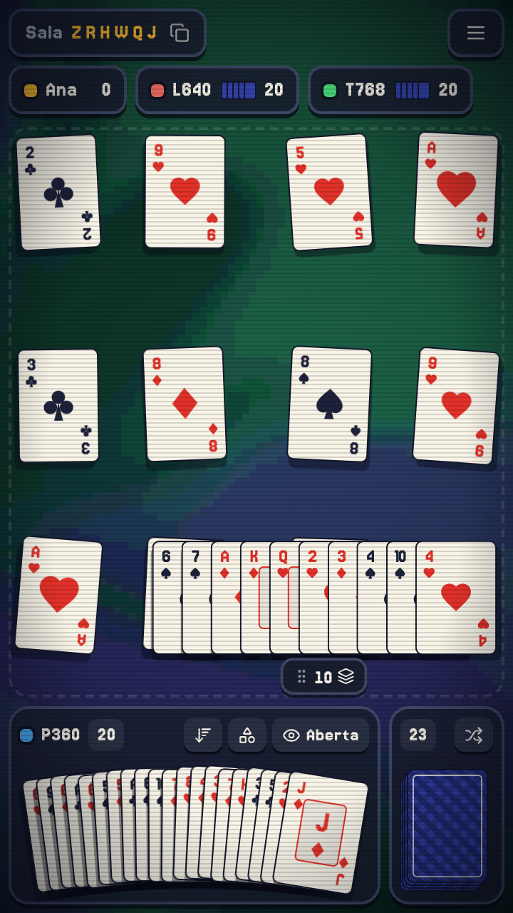
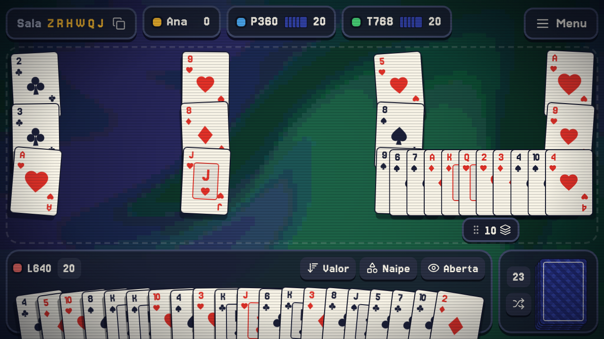

# 8. Responsividade e mobile

## 8.1 Requisitos

- Funcionar de **360x640** (celular pequeno em pé) a monitores grandes.
- Funcionar **deitado**, inclusive em **640x360**.
- **Nenhuma carta fora da tela**, em nenhum tamanho, mesmo que tenha sido
  colocada no canto da mesa por alguém com tela maior.
- Sem rolagem horizontal da página. A página inteira não rola durante o jogo.
- Girar o aparelho no meio da partida reposiciona tudo, sem recarregar.

| Retrato | Paisagem |
|---|---|
|  |  |

## 8.2 Mesa normalizada

A posição de uma carta na mesa é guardada como fração de 0 a 1 do **centro**
da carta dentro da **área útil** da mesa (a área tracejada menos uma margem).
Cada tela projeta essa fração no seu próprio tamanho
([`tableToStage`](../src/game/layout.ts)):

```
x_pixels = inicio_da_area + margem + metade_da_carta + x * (largura_util - carta - 2 * margem)
```

Consequências:

- `x = 1` é sempre "encostado na borda direita, inteira na tela", em qualquer
  aparelho. Não existe posição salva que caia fora da tela.
- A distribuição relativa se mantém: o que está no canto superior esquerdo de
  um jogador está no canto superior esquerdo de todos.
- Em telas muito diferentes as cartas podem se sobrepor mais ou menos, mas
  continuam visíveis e alcançáveis.

Grupos em leque se comprimem para caber na largura e são empurrados para dentro
quando encostariam na borda ([`pileGeometry`](../src/game/layout.ts)).

## 8.3 Tamanho da carta

[`cardSizeFor(largura, altura)`](../src/game/layout.ts) escolhe a altura da
carta pelo menor de dois limites:

- **altura:** cabem a barra superior, umas três fileiras de mesa e a mão;
- **largura:** cabem pelo menos seis cartas lado a lado.

Fica entre 54 e 148 px de altura, proporção 5:7. Tudo dentro da carta é em
`em` relativo à largura, então ela escala inteira.

| Modo | Condição | O que muda |
|---|---|---|
| normal | | mão com cartas 12% maiores que as da mesa |
| `narrow` | largura menor que 640 e não compacto | barra em duas linhas (jogadores descem), mão do mesmo tamanho da mesa |
| `compact` | altura menor que 500 (celular deitado) | mão recolhida (a base das cartas fica para fora da tela), monte ao lado dos controles |

O modo compacto vira o atributo `data-compact` em `.stage`, e o CSS faz o resto.

## 8.4 Layout por CSS, medido por JS

O CSS decide onde cada bloco fica (flex, `flex-wrap` na barra, safe-area).
[`useStageMetrics`](../src/hooks/useStageMetrics.ts) só **mede** as âncoras
(área da mesa, faixa da mão, vaga do monte) com `ResizeObserver` e escuta
`orientationchange` e `visualViewport`. Não há ponto de quebra espalhado em
JavaScript: para mudar o layout, mude o CSS e as medidas acompanham.

## 8.5 Mão

[`handSlots`](../src/game/layout.ts) distribui as cartas em arco. O passo entre
cartas encolhe conforme a mão cresce, com teto de 80% da largura da carta.
Vinte cartas cabem em 360px com o índice de cada uma visível.

## 8.6 Toque

- `touch-action: none` no palco e nas cartas: o navegador não rola nem dá zoom
  durante o arrasto. A lista de jogadores é a exceção (`pan-x`), para rolar
  quando há muitos.
- Limiar de arrasto maior no dedo (9 px) que no mouse (5 px), para um toque
  trêmulo continuar sendo toque.
- Menu de contexto do toque longo desativado no palco.
- Efeitos de hover (inclinação, subir carta da mão) só em `@media (hover: hover)`.
- `viewport-fit=cover` com `env(safe-area-inset-*)`: nada interativo fica
  embaixo do entalhe ou da barra de gestos.

## 8.7 Como testar

Teste pelo menos 360x640, 640x360, 768x1024 e 1440x900. Coloque cartas nos
quatro cantos da mesa em um tamanho e confira nos outros; gire a tela com
cartas na mesa; compre vinte cartas no celular e confira se a mão cabe.
