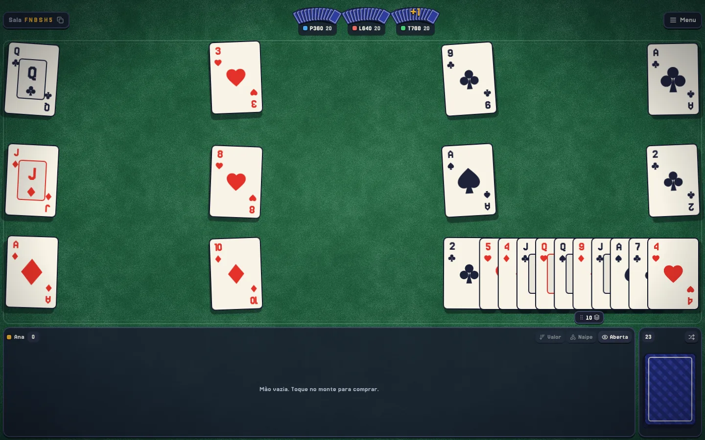

# Documentação do Virtual Card Playground

Uma mesa de cartas livre, em tempo real, para jogar com amigos no navegador do
computador ou do celular. Não há regras de nenhum jogo específico: a mesa
oferece um baralho, a mão de cada jogador e uma área compartilhada, e os
jogadores combinam entre si o que estão jogando.

## Por onde começar

| Se você é... | Leia |
|---|---|
| Agente de IA | [00-regras-para-ia.md](00-regras-para-ia.md), sempre primeiro |
| Pessoa nova no projeto | [09-contexto-do-produto.md](09-contexto-do-produto.md) e depois [01-arquitetura.md](01-arquitetura.md) |
| Quem vai publicar | [02-tecnologias.md](02-tecnologias.md), seção de deploy |

## Índice

| Documento | Conteúdo |
|---|---|
| [00-regras-para-ia.md](00-regras-para-ia.md) | Regras obrigatórias e checklist de fim de tarefa |
| [01-arquitetura.md](01-arquitetura.md) | Camadas, motor do jogo, transportes de tempo real, servidor |
| [02-tecnologias.md](02-tecnologias.md) | Dependências, scripts, variáveis de ambiente, deploy |
| [03-1-identidade-visual.md](03-1-identidade-visual.md) | Paleta, tipografia, cartas, efeitos e animações |
| [03-2-padrao-frontend.md](03-2-padrao-frontend.md) | Como escrever componentes, hooks e estilos |
| [04-componentes.md](04-componentes.md) | Catálogo de páginas, componentes e hooks |
| [05-padroes-de-nomes.md](05-padroes-de-nomes.md) | Nomes de arquivos, tipos, ações, mensagens e chaves |
| [06-banco-de-dados.md](06-banco-de-dados.md) | Modelo do estado da sala e persistência |
| [07-fluxos-aplicacao.md](07-fluxos-aplicacao.md) | Fluxos de entrada, jogo, arrasto e reconexão |
| [08-responsividade-mobile.md](08-responsividade-mobile.md) | Mesa normalizada, tamanho de carta, retrato e paisagem |
| [09-contexto-do-produto.md](09-contexto-do-produto.md) | O que o produto é, para quem, e o que ele não é |
| [10-manutencao-e-granularidade.md](10-manutencao-e-granularidade.md) | Tamanho de arquivo, quando dividir, como comentar |
| [11-servico-de-ia.md](11-servico-de-ia.md) | Situação atual (não há IA) e regras se um dia houver |
| [historico/](historico/) | Registro das mudanças grandes, com data e motivo |
| [assets/](assets/) | Capturas de tela usadas nesta documentação |
